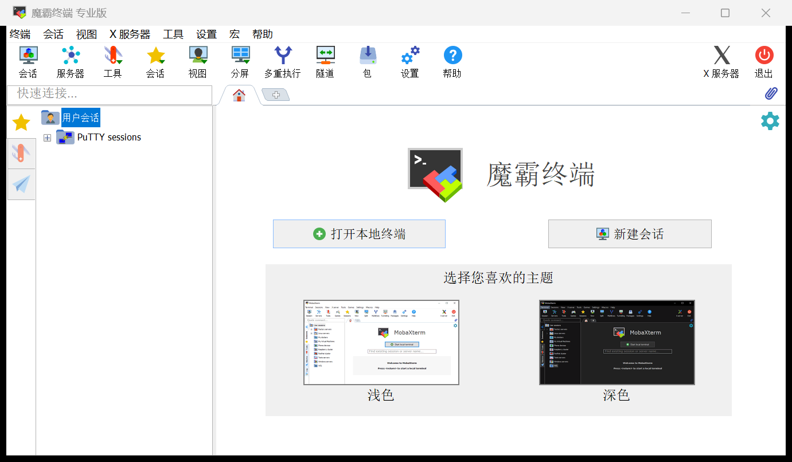

# MobaXterm 简体中文版 v26.5 ——「魔霸终端」

基于 MobaXterm v26.5（Build 5542）的完整简体中文界面，单文件绿色版，开箱即用。



## 成品

**`MobaXterm_魔霸终端_v26.5.exe`** —— 双击直接运行，无需安装。

- 软件名：魔霸终端
- 界面语言：简体中文

## 汉化覆盖

| 载体 | 数量 | 说明 |
|---|---|---|
| Delphi DFM 窗体 | 64 个 / 1974 条 | 菜单栏、会话设置、全部对话框、皮肤主题选择 |
| RT_STRING 资源 | 79 块 / 861 条 | UTF-16 界面文案，逐块逐序号与参考版对齐后整表继承 |
| 代码级字符串 | 145 处 | 标题、快捷操作、状态提示等 |
| 主工具栏按钮 | 13 个 | 通过改写 `HelpKeyword` 实现（见下） |

## 三个关键技术点

### 1. 词库来源

`ref_map.json` 中的 1286 条 EN→ZH 对照是从
[RipplePiam/MobaXterm-Chinese-Simplified](https://github.com/RipplePiam/MobaXterm-Chinese-Simplified)
（v24.3）按**窗体结构路径逐属性对齐**挖出的（`scripts/xalign.py`），
而非人工硬凑，因此术语与现有汉化生态完全一致。
优先级：`ref_map.json` > `trans_map.json` > `trans_zh.EXACT` > 品牌/短语兜底。

文件名、URL、INI 键名、协议名、按钮 ID 一律保护不翻。

### 2. 字体策略：什么都不改

原版使用 Arial / Tahoma / Verdana + `DEFAULT_CHARSET`。
**不要**把它们换成中文字体——参考中文实现同样未改字体，靠 Windows 的
字体链接（font-linking，Arial→宋体回退）渲染中文。
换字体（哪怕换成微软雅黑）会改变字形度量，导致固定尺寸控件里的文字被裁剪，
表现为「文本显示不全」。

### 3. 主工具栏按钮为什么不能用 DFM Caption 汉化

v26.5 的主工具栏（会话 / 服务器 / 工具 …）**运行时把按钮的 `HelpKeyword`
当作 Caption 绘制**，DFM 里的 `Caption` 属性会被覆盖 —— 这就是为什么

- 直接改 DFM `Caption` → 界面无变化（已实测验证）；
- 改资源目录 / 清空 `.rsrc` / 清空 `BASEPROF` → 界面均无变化。

正确做法：把 `sPanel4` 下各按钮的 `HelpKeyword` 改写成对应的中文
（`localize.py` 中 `TOPBAR_HELPKEYS` 一组开关控制）。
按钮的 `HelpKeyword` 同时是配置标识，因此 `TopToolbarBtns` 默认值表
（`0x5042dc`）与 `Toolbar` / `Session` 等 INI 键名（`0x5b5e4c`）
必须在 `patch_code.py` 中列入保护区间，否则工具栏会因匹配失败回退英文。

## 构建流水线

```
MobaXterm_Installer_v26.5.zip
  → MobaXterm.exe（解包 .msi → CAB）
  → （私有步骤）写入软件名称与用户署名
  → python scripts/localize.py     # DFM 全量汉化 + RT_STRING 继承 + 工具栏 HelpKeyword（新增 .rscn 资源节）
  → python scripts/patch_code.py   # 代码级字符串汉化 + PE 校验和重算
  → build/MobaXterm_zh.exe
```

辅助工具：`dfm.py`（Delphi 二进制 DFM 读写）、`xalign.py`（跨版本结构对齐挖词）、
`rtres.py`（RT_STRING 整块继承）、`memscan*.py`（运行时内存取证）。

## 免责声明

本项目仅供学习研究使用。MobaXterm 版权归 Mobatek 所有，
请通过 https://mobaxterm.mobatek.net/ 获取官方版本。
